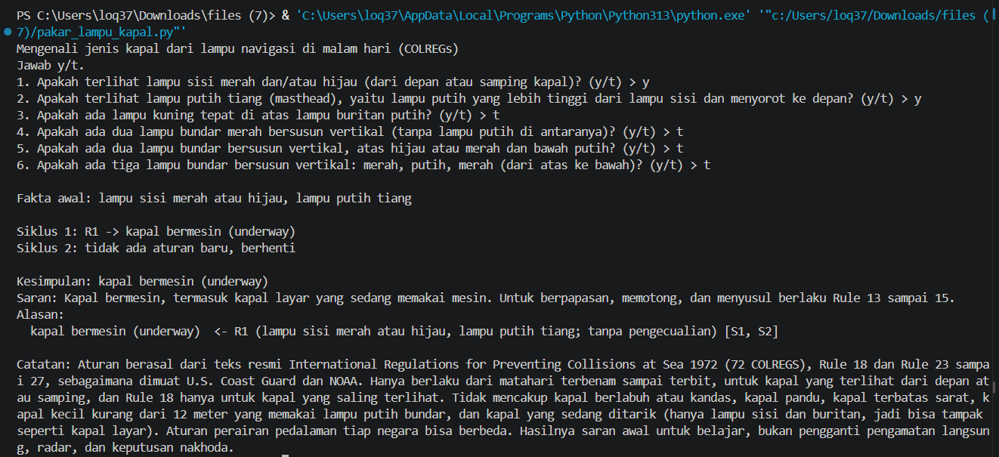
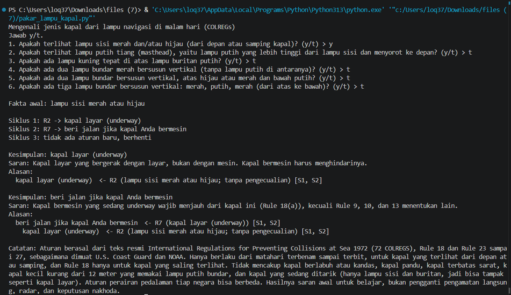
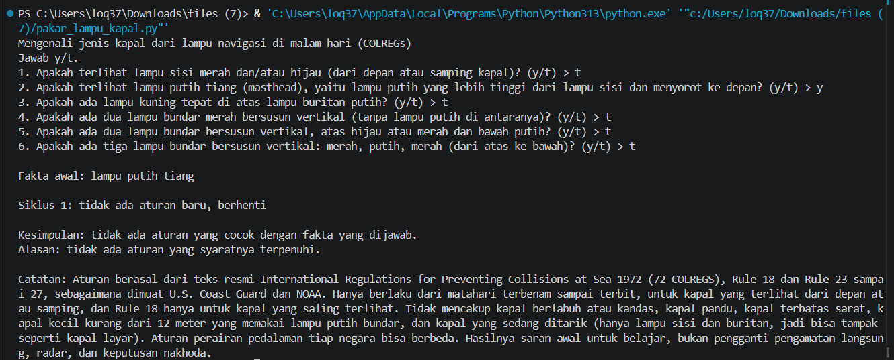
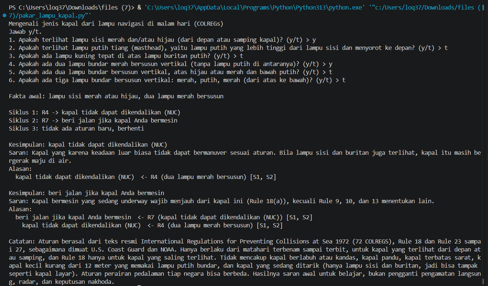

# Tugas 5 AI: Sistem Pakar Mengenali Kapal dari Lampu Navigasi

## 1. Identitas

- Nama: Ariyanta Nugraha Abdullah
- NIM: F1D02510002
- Mata kuliah: Kecerdasan Buatan (MKL1303131), Teknik Informatika, Universitas Mataram

## 2. Topik dan cara menjalankan

**Topik:** mengenali jenis kapal dari lampu navigasinya di malam hari, lalu menyimpulkan siapa yang harus memberi jalan. Aturannya berasal dari International Regulations for Preventing Collisions at Sea 1972 (COLREGs), yaitu aturan lalu lintas laut yang dibuat IMO dan dipakai di seluruh dunia.

**Isi repository:**

| File | Fungsi |
|------|--------|
| `kb_lampu_kapal.json` | Basis pengetahuan: sumber, pertanyaan, 7 aturan IF-THEN, 7 kesimpulan |
| `pakar_lampu_kapal.py` | Mesin forward chaining yang membaca file JSON |
| `screenshot/` | Tangkapan layar kasus uji |

**Cara menjalankan** (Python 3.13.4, tanpa library tambahan):

```
python pakar_lampu_kapal.py
```

Jawab `y` atau `t` untuk 6 pertanyaan. Untuk uji cepat tanpa pertanyaan, pakai `--ya` diikuti nomor pertanyaan yang dijawab ya, misalnya `python pakar_lampu_kapal.py --ya 1,2`.

Nomor pertanyaan: 1 lampu sisi merah/hijau, 2 lampu putih tiang, 3 lampu kuning di atas lampu buritan, 4 dua lampu merah bersusun, 5 lampu hijau atau merah di atas lampu putih, 6 lampu merah-putih-merah bersusun.

## 3. Sumber dan aturan

### Sumber

| Kode | Judul | Penerbit | URL | Diakses |
|------|-------|----------|-----|---------|
| S1 | USCG Amalgamated Navigation Rules International & U.S. Inland (72 COLREGS) | U.S. Coast Guard Navigation Center | https://navcen.uscg.gov/navigation-rules-amalgamated | 9 Nov 2026 |
| S2 | International & U.S. Inland Navigation Rules (Amalgamated Navigation Rules Handbook) | NOAA Office of Coast Survey | https://navcen.uscg.gov/sites/default/files/pdf/navRules/Handbook/NOAANavigationRulesStandardSize.pdf | 9 Nov 2026 |

Keduanya memuat teks resmi 72 COLREGS yang dibuat IMO. Bagian yang dipakai: Rule 18, Rule 23 sampai 27 (dan definisi lampu di Rule 21). Aturan di bawah adalah parafrasa bahasa Indonesia, bukan kutipan. Bagian Inland (perairan pedalaman AS) tidak dipakai.

### Tabel aturan

| Aturan | IF | THEN | Sumber |
|--------|----|------|--------|
| R1 | lampu sisi merah atau hijau **AND** lampu putih tiang, **kecuali** lampu kuning di atas buritan / dua lampu merah / hijau atau merah di atas putih / merah-putih-merah | kapal bermesin (underway) | S1, S2 |
| R2 | lampu sisi merah atau hijau, **kecuali** lampu putih tiang / dua lampu merah / hijau atau merah di atas putih / merah-putih-merah | kapal layar (underway) | S1, S2 |
| R3 | lampu kuning di atas lampu buritan | kapal tunda (menarik di belakang) | S1, S2 |
| R4 | dua lampu merah bersusun | kapal tidak dapat dikendalikan (NUC) | S1, S2 |
| R5 | lampu hijau atau merah di atas lampu putih | kapal sedang menangkap ikan | S1, S2 |
| R6 | lampu merah-putih-merah bersusun | kapal terbatas kemampuan manuver (RAM) | S1, S2 |
| R7 | kapal layar **OR** kapal NUC **OR** kapal menangkap ikan **OR** kapal RAM | beri jalan jika kapal Anda bermesin | S1, S2 |

Rantai aturan (hasil satu aturan dipakai aturan lain): R2, R4, R5, atau R6 menghasilkan jenis kapal, lalu R7 memakai hasil itu.

Dasar tiap aturan dalam sumber:

- R1 (Rule 23): kapal bermesin yang sedang underway menunjukkan lampu tiang di depan, lampu sisi (hijau di kanan, merah di kiri), dan lampu buritan. Kapal layar yang memakai mesin dianggap kapal bermesin (Rule 3).
- R2 (Rule 25): kapal layar yang sedang underway hanya menunjukkan lampu sisi dan lampu buritan, tanpa lampu tiang.
- R3 (Rule 24): kapal bermesin yang menarik di belakang menunjukkan lampu kuning tepat di atas lampu buritan.
- R4 (Rule 27(a)): kapal tidak dapat dikendalikan menunjukkan dua lampu merah bundar bersusun vertikal.
- R5 (Rule 26): kapal menangkap ikan menunjukkan dua lampu bundar bersusun, hijau di atas putih untuk pukat tarik dan merah di atas putih untuk penangkapan lain.
- R6 (Rule 27(b)): kapal terbatas kemampuan manuver menunjukkan tiga lampu bundar bersusun: merah, putih, merah.
- R7 (Rule 18(a)): kapal bermesin yang sedang underway harus menjauh dari kapal tidak dapat dikendalikan, kapal terbatas manuver, kapal menangkap ikan, dan kapal layar.

**Catatan tentang "kecuali":** selain `jika` dan `mode`, sebuah aturan boleh punya daftar `kecuali`. Aturan tidak dijalankan bila salah satu fakta `kecuali` ada di memori. Ini perlu karena kapal khusus (misalnya kapal ikan atau kapal RAM yang sedang bergerak) juga menunjukkan lampu sisi, sehingga tanpa pengecualian bisa salah dikira kapal biasa. Fakta di `kecuali` selalu fakta yang ditanyakan ke user, bukan hasil aturan, supaya urutan eksekusi tidak mengubah hasil.

## 4. Metode: Forward Chaining

Forward chaining dipilih karena yang kita punya adalah fakta pengamatan (lampu apa saja yang terlihat), lalu kita ingin sampai ke kesimpulan jenis kapal dan tindakan. Itu alur dari fakta menuju kesimpulan. Mesinnya ditulis sendiri di `pakar_lampu_kapal.py`.

```
memori <- fakta yang dijawab "ya" oleh user
ULANGI:
    cocok <- aturan yang syaratnya terpenuhi, tidak terblokir "kecuali",
             DAN hasilnya belum ada di memori
    JIKA cocok kosong: BERHENTI
    r <- cocok[0]
    tambahkan r.maka ke memori
    catat bahwa r.maka berasal dari r      # bahan "alasan"
```

Aturan yang hasilnya sudah ada tidak dijalankan lagi, sehingga program pasti berhenti. Alasan dicetak dengan menelusuri balik dari kesimpulan lewat catatan aturan penyebabnya.

## 5. Kasus uji dan screenshot

| # | Jawaban "ya" (nomor pertanyaan) | Kesimpulan |
|---|---------------------------------|------------|
| 1 | lampu sisi, lampu putih tiang (`--ya 1,2`) | kapal bermesin (underway) |
| 2 | lampu sisi saja (`--ya 1`) | kapal layar (underway), beri jalan jika kapal Anda bermesin |
| 3 | lampu putih tiang saja (`--ya 2`) | **tidak ada** (kasus negatif) |
| 4 | lampu sisi, dua lampu merah bersusun (`--ya 1,4`) | kapal tidak dapat dikendalikan (NUC), beri jalan |
| 5 | lampu sisi, lampu putih tiang, lampu kuning di atas buritan (`--ya 1,2,3`) | kapal tunda |
| 6 | hijau atau merah di atas putih (`--ya 5`) | kapal sedang menangkap ikan, beri jalan |
| 7 | lampu sisi, lampu putih tiang, merah-putih-merah (`--ya 1,2,6`) | kapal terbatas kemampuan manuver (RAM), beri jalan |

Kasus 5 menunjukkan "kecuali" bekerja: lampu sisi dan lampu putih tiang biasanya berarti kapal bermesin (R1), tetapi lampu kuning memblokir R1 sehingga yang keluar hanya kapal tunda.

### Kasus 1

Keluaran utama:

```
Kesimpulan: kapal bermesin (underway)
Alasan:
  kapal bermesin (underway)  <- R1 (lampu sisi merah atau hijau, lampu putih tiang; tanpa pengecualian) [S1, S2]
```



### Kasus 2 (rantai aturan)

Keluaran utama:

```
Kesimpulan: beri jalan jika kapal Anda bermesin
Alasan:
  beri jalan jika kapal Anda bermesin  <- R7 (kapal layar (underway)) [S1, S2]
    kapal layar (underway)  <- R2 (lampu sisi merah atau hijau; tanpa pengecualian) [S1, S2]
```



### Kasus 3 (negatif)

Keluaran utama:

```
Kesimpulan: tidak ada aturan yang cocok dengan fakta yang dijawab.
Alasan: tidak ada aturan yang syaratnya terpenuhi.
```



### Kasus 4

```
Kesimpulan: kapal tidak dapat dikendalikan (NUC)
Alasan:
  kapal tidak dapat dikendalikan (NUC)  <- R4 (dua lampu merah bersusun) [S1, S2]
```



## 6. Batas keberlakuan

Pengetahuan dalam sistem ini berasal dari teks resmi 72 COLREGS (Rule 18 dan Rule 23 sampai 27) yang dimuat U.S. Coast Guard dan NOAA, bukan dari penelitian saya sendiri. Aturannya hanya untuk malam hari (dari matahari terbenam sampai terbit) dan untuk kapal yang terlihat dari depan atau samping; Rule 18 pun hanya berlaku untuk kapal yang saling terlihat dan tidak menggantikan aturan alur sempit, skema pemisah lalu lintas, dan menyusul. Sistem tidak mencakup kapal berlabuh atau kandas, kapal pandu, kapal terbatas sarat, kapal kecil kurang dari 12 meter yang memakai lampu putih bundar, dan kapal yang sedang ditarik (hanya menunjukkan lampu sisi dan buritan sehingga bisa tampak seperti kapal layar). Aturan perairan pedalaman tiap negara bisa berbeda. Hasilnya saran awal untuk belajar, bukan pengganti pengamatan langsung, radar, dan keputusan nakhoda. Catatan ini juga ditampilkan oleh program di akhir setiap keluaran.

## 7. Penggunaan alat bantu AI

Claude (Anthropic) dipakai untuk membantu mencari dan membaca sumber, kode Python, dan draf README. Saya sudah membaca sumbernya, memeriksa aturan terhadap sumber, menjalankan sendiri programnya, dan mengerti cara kerja kode dan aturan ini.
